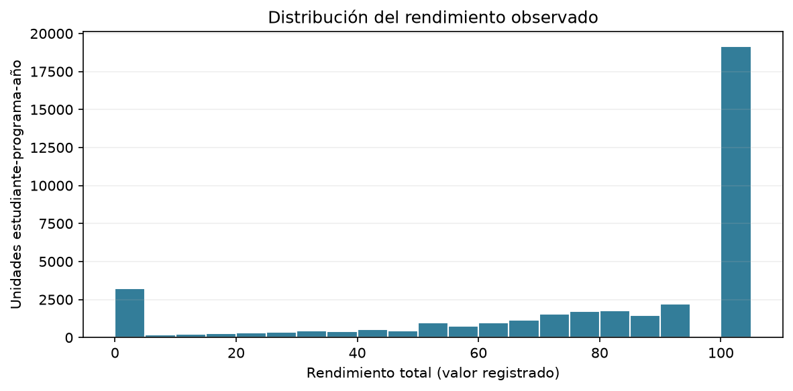
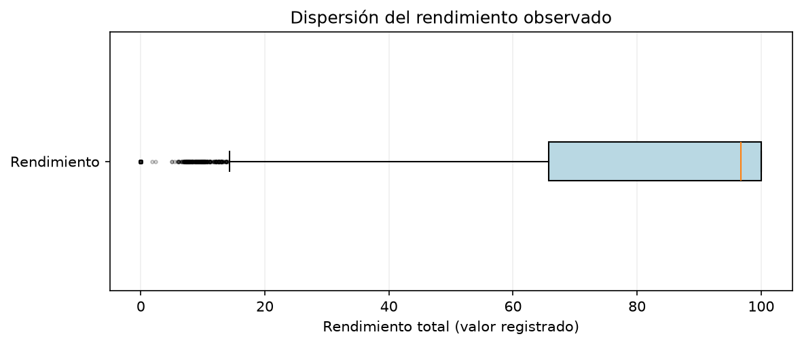
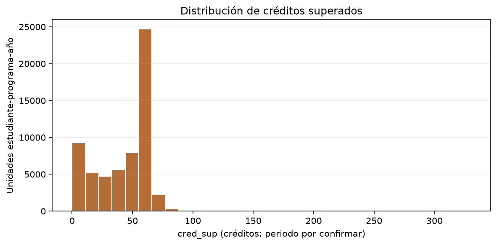
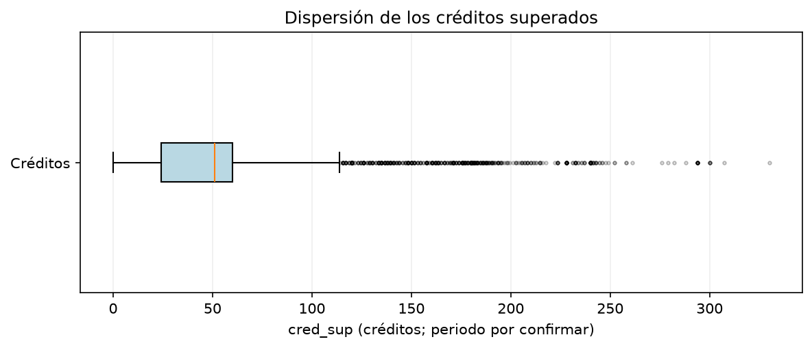
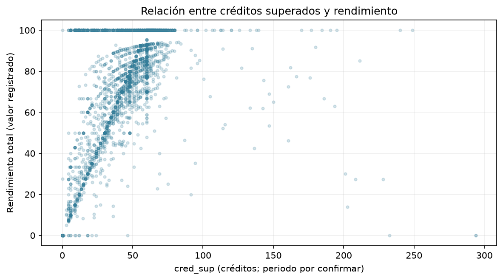
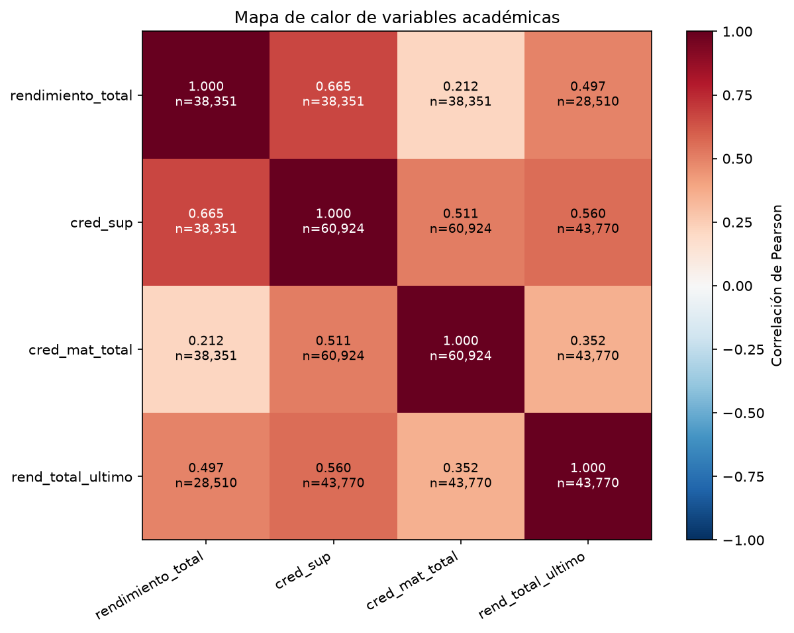
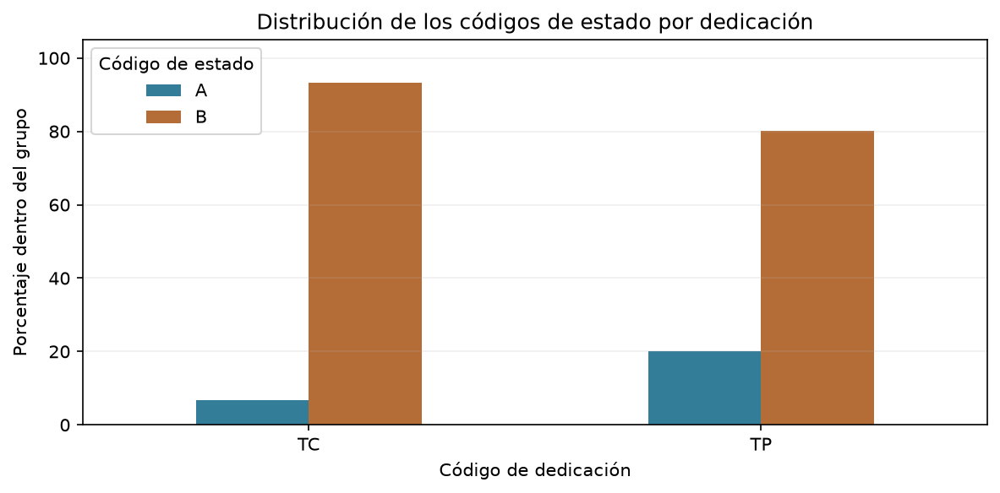

# Informe de laboratorio: análisis exploratorio de deserción universitaria

## 1. Portada y contexto

**UNIMINUTO · Ingeniería de Sistemas · Minería de Datos** 
**Docente:** Esteban Ernesto Morales Castro 
**Integrantes:** Jonathan Díaz Salgado y Diego Alberto Ñanguma Briñez 
**Fecha:** 18 de octubre de 2026

**Pregunta:** ¿qué características académicas y de contexto pueden relacionarse con el abandono universitario y orientar un futuro análisis de riesgo?

**Objetivo:** describir las variables académicas disponibles, verificar su calidad y explorar asociaciones para formular recomendaciones prudentes. No se entrena un predictor en este avance.

La fuente es StudentDropoutDataset (Zenodo, CC BY 4.0), de una universidad española. La base recibida contiene 464.739 matrículas en asignaturas y 39.364 identificadores de persona distintos. No son datos de estudiantes de UNIMINUTO.

Se propone la unidad estudiante-programa-año y la mediana de las variables numéricas de cada grupo. La vista resultante tiene 60.924 unidades. Una persona puede aparecer en varios años/programas, por lo que no se asume independencia estadística.

## 2. Calidad de datos

Se verificaron las 464.739 filas y todas las columnas de la tabla original para detectar filas idénticas: **cero duplicados exactos**. Tampoco hay claves incompletas en las variables usadas. La repetición de una persona en distintas asignaturas no se trató como duplicación errónea.

El rendimiento está ausente en todo 2018. La tabla preparada lo rellenó con 93,02; ese relleno no se interpreta como rendimiento medido. La vista analítica conserva los faltantes originales, usa los valores disponibles y comunica la cobertura.

| cohorte | filas | observados | faltantes | minimo_preparado | maximo_preparado |
| --- | --- | --- | --- | --- | --- |
| 2018 | 152446 | 0 | 152446 | 93.020 | 93.020 |
| 2021 | 153120 | 144470 | 8650 | 60.225 | 100.000 |
| 2022 | 159173 | 150354 | 8819 | 60.225 | 100.000 |

Las categorías se normalizan conservando ausencias. Los códigos son consistentes dentro de las unidades observadas; no se encontraron conflictos de estado ni dedicación. Los extremos se cuantifican con IQR, se conservan y se recomienda verificar el contexto antes de recortarlos.

Los límites IQR detectan observaciones para revisión; no son los límites académicos oficiales.

| variable | n_observados | limite_inferior | limite_superior | n_extremos |
| --- | --- | --- | --- | --- |
| rendimiento_total | 38351 | 14.275 | 151.435 | 3640 |
| cred_sup | 60924 | -30.000 | 114.000 | 552 |
| cred_mat_total | 60924 | 26.250 | 80.250 | 8410 |
| rend_total_ultimo | 43770 | 25.000 | 145.000 | 3141 |

## 3. Análisis univariado

Las cuatro figuras estudian una variable a la vez. La tabla descriptiva informa cobertura, centro y dispersión. Las unidades exactas, periodos y fórmulas deben contrastarse con el diccionario autorizado.

| variable | count | mean | 50% | 25% | 75% | faltantes | asimetria |
| --- | --- | --- | --- | --- | --- | --- | --- |
| rendimiento_total | 38351.000 | 77.524 | 96.770 | 65.710 | 100.000 | 22573 | -1.390 |
| cred_sup | 60924.000 | 43.125 | 51.000 | 24.000 | 60.000 | 0 | 0.992 |
| cred_mat_total | 60924.000 | 51.846 | 60.000 | 46.500 | 60.000 | 0 | -0.840 |
| rend_total_ultimo | 43770.000 | 80.672 | 100.000 | 70.000 | 100.000 | 17154 | -1.558 |

### Figura 1. Histograma de rendimiento

**Interpretación:** se dispone de rendimiento para **38,351** de **60,924** unidades. La mediana es **96.77** y la media **77.52**. El 50% central está entre **65.71** y **100.00**. Estos resultados corresponden a los valores disponibles, no a toda la población.

### Figura 2. Boxplot de rendimiento

**Interpretación:** la mediana es **96.77**. Los límites IQR son **14.27** y **151.44**. Se señalan **3,640** extremos de **38,351** valores observados. Se conservan hasta comprobar su significado académico.

### Figura 3. Histograma de créditos

**Interpretación:** hay **60,924** valores disponibles. La mediana es **51.00**, la media **43.12** y la asimetría **0.99**. La diferencia entre media y mediana debe tenerse en cuenta al describir el valor típico; los créditos altos requieren revisar si corresponden a un periodo acumulado.

### Figura 4. Boxplot de créditos

**Interpretación:** la mediana es **51.00**. Los límites IQR son **-30.00** y **114.00**; **552** de **60,924** valores quedan fuera. Se mantienen en el análisis porque no hay evidencia suficiente para tratarlos como errores.

## 4. Análisis bivariado y multivariado

Se usa Pearson con pares disponibles; se informa n y se excluyen identificadores/códigos nominales de la matriz numérica. La fuerza se clasifica por |r|: <0,1 sin relación lineal apreciable; [0,1;0,3) débil; [0,3;0,5) moderada; [0,5;0,7] fuerte; >0,7 muy fuerte. El signo indica dirección. Los casos sin variación o pares suficientes no se definen. Correlación no demuestra causalidad.

La función de clasificación y sus comprobaciones están en el notebook anexo.

### Figura 5. Dispersión de créditos y rendimiento

**Interpretación:** r = **0.665**, con **38,351** pares: **Fuerte, dirección positiva**. Los valores tienden a aumentar juntos. La relación puede depender de cómo se calculan las variables; no demuestra que aumentar los créditos cause mejor rendimiento ni menor abandono.

### Figura 6. Mapa de calor

**Conclusión del mapa:** rendimiento y créditos superados presentan una relación **Fuerte, dirección positiva** (r = **0.665**). Rendimiento total y el campo `rend_total_ultimo` tienen r = **0.497**, clasificada como **Moderada, dirección positiva**. Se propone revisar estos cruces, sus fórmulas y periodos antes de usarlos como posibles indicadores. Las relaciones observadas no son evidencia causal sobre deserción.

| variable_1 | variable_2 | pares_validos | r | clasificacion |
| --- | --- | --- | --- | --- |
| rendimiento_total | cred_sup | 38351 | 0.665 | Fuerte, dirección positiva |
| rendimiento_total | cred_mat_total | 38351 | 0.212 | Débil, dirección positiva |
| rendimiento_total | rend_total_ultimo | 28510 | 0.497 | Moderada, dirección positiva |
| cred_sup | cred_mat_total | 60924 | 0.511 | Fuerte, dirección positiva |
| cred_sup | rend_total_ultimo | 43770 | 0.560 | Fuerte, dirección positiva |
| cred_mat_total | rend_total_ultimo | 43770 | 0.352 | Moderada, dirección positiva |

### Figura 7. Cruce de estado y dedicación

**Interpretación:** TC: 6.67% de código A (n=59,211); TP: 19.96% de código A (n=1,713). Las proporciones difieren entre grupos. Se recomienda confirmar los códigos y revisar la mezcla de años/programas antes de atribuir la diferencia a dedicación o denominarla deserción.

**Cruce por año del archivo:** los códigos se muestran sin denominarlos deserción. A/B y TC/TP necesitan su definición autorizada antes de traducirlos a categorías de negocio.

| cohorte | A | B |
| --- | --- | --- |
| 2018 | 1436 | 18797 |
| 2021 | 1364 | 18900 |
| 2022 | 1494 | 18933 |

## 5. Hallazgos y recomendaciones

### Hallazgo 1

No hay rendimiento original disponible para 2018.

**Evidencia:** 152,446 faltantes de 152,446 matrículas de ese año; tabla de revisión inicial.

**Acción sugerida:** Solicitar documentación de disponibilidad y analizar por año; no presentar el relleno como rendimiento medido.

### Hallazgo 2

Rendimiento y créditos presentan asociación fuerte, dirección positiva.

**Evidencia:** r=0.665; 38,351 pares; figuras 5 y 6.

**Acción sugerida:** Revisar si comparten fórmula o periodo y evaluar redundancia antes de proponer indicadores de acompañamiento.

### Hallazgo 3

El rendimiento total se asocia con el campo de rendimiento previo: moderada, dirección positiva.

**Evidencia:** r=0.497; 28,510 pares; figura 6.

**Acción sugerida:** Confirmar qué periodo representa el campo previo y estudiar la relación por año antes de usarla para alertas.

### Hallazgo 4

La proporción del código A difiere entre las categorías de dedicación registradas.

**Evidencia:** TC: 6.67% de código A (n=59,211); TP: 19.96% de código A (n=1,713); tabla cruzada y figura 7.

**Acción sugerida:** Confirmar el mapa de A/B y los códigos de dedicación; después contrastar la diferencia por año y programa antes de sugerir acompañamiento específico.

### Conclusiones y límites

El análisis identifica un problema de disponibilidad en 2018, cuantifica extremos y muestra asociaciones académicas y diferencias entre códigos de estado. Las cifras orientan revisiones posteriores, sin probar causas ni estimar precisión predictiva.

Los estados A/B y el horizonte de abandono siguen pendientes de definición. Por tanto, los cruces están calculados pero su interpretación en términos de deserción está pendiente. También deben validarse fórmulas, unidades, periodos y la unidad de análisis propuesta. La cobertura es distinta entre variables y las personas pueden repetirse entre años/programas.

## 6. Anexos y referencias

- `EDA_Desercion_Entrega.ipynb`: código completo ejecutado, con explicaciones y siete figuras interpretadas.
- `resultados_entrega/`: figuras, descriptivos, correlaciones, cruces, hallazgos, bitácora, CSV analítico y diccionario de todas sus columnas. Los faltantes conservados tienen una decisión explícita; no se ocultan como cero.
- Para repetir, colocar la base junto al notebook y ejecutar en Python con pandas, numpy y matplotlib. La conexión es de solo lectura. La comprobación completa de duplicados puede tardar varios minutos.

**Referencias:** [StudentDropoutDataset, DOI 10.5281/zenodo.17239943](https://doi.org/10.5281/zenodo.17239943); material docente de sesión 5, pp. 8 y 27–31; sesión 6, pp. 11–13; [repositorio del equipo](https://github.com/daiz2018/mineria_de_datos).

Trabajo elaborado con apoyo de IA. Los integrantes deben revisar y comprender decisiones y resultados y cumplir las condiciones de uso de IA de la asignatura. No se modificó la base ni se hizo push al repositorio.
